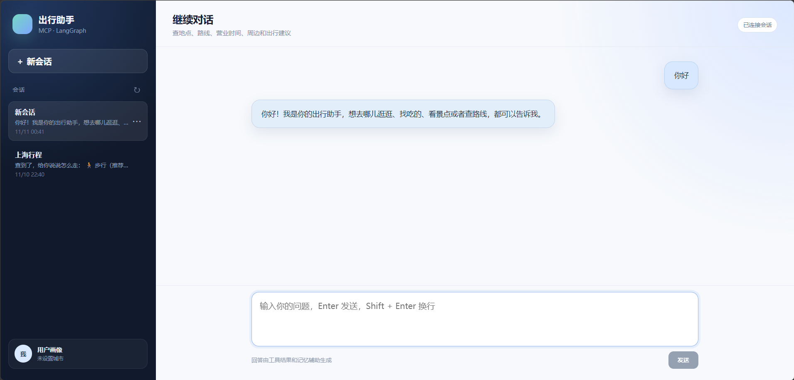

# 智能出行助手

基于 MCP 工具检索与 LangGraph 多节点编排的出行助手，包含 FastAPI 后端和 Vue3 前端。

> 个人项目 / 本地 Demo，非生产级系统。



## 功能

- MCP 工具动态召回与按需加载
- LangGraph 多节点 Agent 工作流
- 工具参数校验、可修复错误重试、失败降级
- 分层记忆：用户画像 + 会话历史记忆
- 用户画像查看与修改
- 会话列表、历史消息、重命名、删除
- SSE 流式回答
- Redis 工具结果缓存

## 技术栈

```text
后端：Python / FastAPI / LangGraph / LangChain / MCP
存储：PostgreSQL / Milvus / Redis
前端：Vue3 / TypeScript / Vite
模型：DeepSeek / DashScope Embedding / Rerank
```

## 架构

```text
Vue3
  │
  ▼
FastAPI
  │
  ▼
ChatService
  │
  ▼
LangGraph
  ├── analyze      查询分析
  ├── retrieve     工具/记忆召回
  ├── agent        工具选择与回答
  ├── validate     参数校验
  └── tools        工具执行
        │
        ├── MCP 工具
        ├── PostgreSQL   会话、画像、Checkpoint
        ├── Milvus       工具库、历史记忆
        └── Redis        工具结果缓存
```

## 目录

```text
mcp_tools_rag/      LangGraph 图、节点、API
services/           MCP、检索、缓存、会话、画像
migrations/         PostgreSQL 建表 SQL
scripts/            回填、清理、调试脚本
frontend/           Vue3 前端
docker-compose.yml  PostgreSQL / Redis / Milvus
```

## 快速启动

### 1. 配置环境变量

```powershell
Copy-Item .env.example .env
```

填写：

```text
DEEPSEEK_API_KEY
DASHSCOPE_API_KEY
AMAP_API_KEY
MINERU_TOKEN
```

### 2. 启动依赖服务

```powershell
docker compose up -d
```

包含：

```text
PostgreSQL  localhost:5432
Redis       localhost:6379
Milvus      localhost:19530
```

首次启动 Postgres 会自动执行 `migrations/001_create_threads.sql`。

如果数据库卷已存在，迁移不会重复执行，可手动执行：

```powershell
docker compose exec -T postgres psql -U postgres -d travel_assistant `
  < migrations/001_create_threads.sql
```

### 3. 启动后端

```powershell
python -m venv .venv
.\.venv\Scripts\Activate.ps1
pip install -r requirements.txt
uvicorn mcp_tools_rag.app.main:app --reload --port 8000
```

接口文档：

```text
http://127.0.0.1:8000/docs
```

### 4. 启动前端

```powershell
cd frontend
npm install
npm run dev
```

打开：

```text
http://127.0.0.1:5173
```

## 主要接口

```text
POST   /api/chat
POST   /api/chat/stream
GET    /api/threads
GET    /api/threads/{thread_id}/messages
PATCH  /api/threads/{thread_id}
DELETE /api/threads/{thread_id}
GET    /api/profile
PATCH  /api/profile
GET    /health
```

## 工具与数据初始化

工具库：

```powershell
python scripts/backfill_tools.py
```

历史会话回填：

```powershell
python scripts/backfill_threads.py
python scripts/backfill_memory.py
```

## 已知限制

- 当前使用固定测试用户，没有登录鉴权
- 仅本地运行，没有正式部署
- 没有生产级监控、限流和多租户权限
- RAG 评估集较小，指标仅用于方向性对比
- Milvus 和 embedding 依赖外部服务，首次启动较慢

## 说明

`LANGCHAIN_TRACING_V2=false` 可关闭 LangSmith 上传，避免网络超时影响本地运行。
